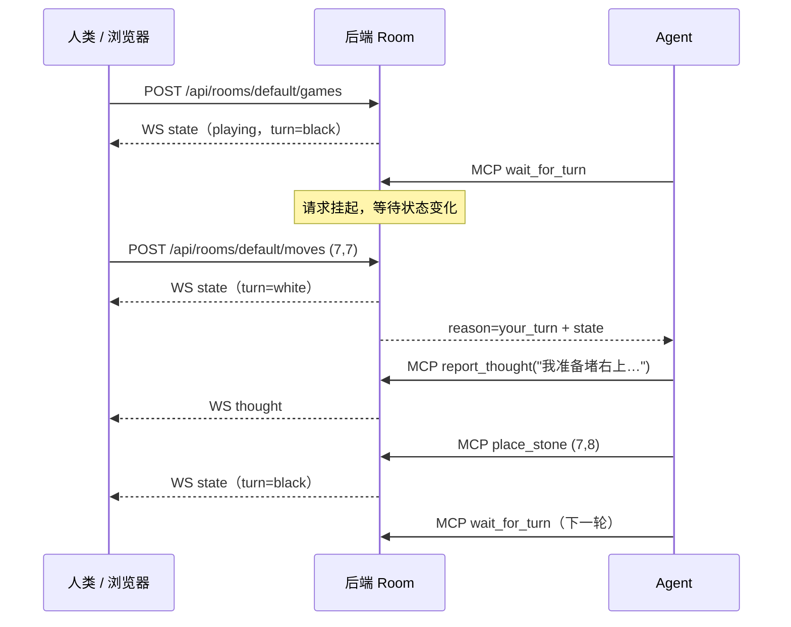

# 五子棋 MCP 对弈系统 · 设计文档

> 版本：v0.3（可扩展设计 + AI 思考展示）
> 日期：2026-10-22
> 项目路径：`E:\code\fun\gomoku-mcp`
> 技术栈：Node.js + TypeScript（单进程后端） / Vite + React（前端）

---

## 1. 目标与范围

一句话：**人类在浏览器棋盘上落子，AI Agent 通过 MCP 工具接入同一局棋，实现「网页人类 vs 大模型」的实时对弈。**

设计上不绑定任何特定 Agent：只要客户端实现标准 MCP，就能接入。

### 1.1 已确认决策

- 默认人类执黑、AI 执白；网页可选择执黑 / 执白
- UI：极简木色棋盘 + 深色背景
- v1 不做悔棋
- 网页展示 AI 思考内容（通过 `report_thought`，见 §3）
- 首批联调客户端：Command Code、zcode、dsh（暂不实测 Claude Code / Codex）

### 1.2 v1 范围

- 15×15 标准无禁手五子棋，黑先，五连（含长连）获胜
- 房间模型：后端支持多房间，v1 UI 只使用 `default` 房间
- 浏览器：开局、落子、认输、实时观战、断线重连、AI 思考面板
- MCP：6 个工具，**Streamable HTTP + stdio 双传输**
- 单进程同时提供页面静态资源、REST/WS、MCP HTTP 入口
- 本地运行，默认仅监听 `127.0.0.1`
- 前后端共享 TypeScript 类型（`shared` workspace）

### 1.3 非目标（v1 不做）

- 多房间 UI / 匹配 / 账号体系
- 禁手规则、悔棋、计时器
- 公网部署、鉴权
- 数据库持久化（只保留接口缝）
- AI vs AI 自动编排
- 逐 token 的 AI 思考流（MCP 模式下做不到，见 §3）
- 依赖 MCP sampling / elicitation / notifications 等客户端高级能力

---

## 2. 核心问题：回合同步

MCP 的调用方向是 **Agent → Server**；而人类落子发生在浏览器（**浏览器 → Server**）。服务端无法「主动叫醒」Agent —— MCP 没有让客户端自动开始一轮推理的推送通道。

解法：提供一个**长轮询工具 `wait_for_turn`**。Agent 调用后请求挂起，直到：

1. 轮到 Agent（人类已落子）
2. 棋局结束
3. 开了新局
4. 超时



### 2.1 `wait_for_turn` 语义

| 调用时状态 | 行为 | 返回 reason |
|---|---|---|
| `idle` | 立即返回 | `idle` |
| `finished` | 立即返回 | `game_over` |
| `playing`，轮到 Agent | 立即返回 | `your_turn` |
| `playing`，轮到人类 | 挂起至状态变化或超时 | `your_turn` / `game_over` / `new_game` / `timeout` |

- 默认超时 20s，参数范围 1s–60s
- **超时不是错误**：返回当前 `state` + `reason=timeout`，工具描述引导 Agent 再次调用
- Agent 侧推荐循环：`wait_for_turn` → 思考 / `report_thought` → `place_stone` → `wait_for_turn`
- 实现：每个 Room 持有 `Set<Waiter>`，状态变更时统一 resolve；每个 waiter 持有定时器
- 竞态：状态变更在 Room 方法内同步串行完成，每次变更 `version++`；响应始终携带完整 `state`
- waiter 的 resolve 条件独立于颜色：`status !== 'playing'`、`turn === seat`、`gameId` 变化

### 2.2 为什么不用轮询 `get_state`

会产生大量无意义调用和 token 消耗；长轮询把等待成本留在服务端。

为什么不用 MCP notifications：客户端不会因为收到通知就自动触发一轮 Agent 推理。

### 2.3 跨客户端行为差异

| 差异点 | 影响 | 对策 |
|---|---|---|
| 工具调用超时不同 | 长轮询可能被客户端提前掐断 | 默认 20s 有界等待，超时作为正常结果返回，Agent 再调 |
| server instructions 不一定展示 | Agent 可能不知道对局流程 | 完整流程写进每个 tool 的 description |
| Agent 不一定会连续调用工具 | 超时后可能直接结束回合 | tool description 明确要求循环；用户也可回复「继续」 |
| 部分客户端只支持 stdio | 无法直连 HTTP 端点 | 提供 stdio 桥接入口，共用同一套 tool 定义 |
| 客户端可能运行在 WSL/Docker | `127.0.0.1` 语义不同 | stdio 是最稳路径；HTTP 场景按实际网络调整地址 |

结论：**只用 tools 这一个 MCP 原语**，不依赖通知、采样、elicitation，保证最大兼容性。

### 2.4 超时值

先用 20s：覆盖人类思考，又低于大多数 MCP 客户端的默认工具超时。联调时实测各客户端上限，再调整，硬上限 60s。

---

## 3. AI 思考内容：能做什么、不能做什么

### 3.1 能力边界

外部 Agent 的原始推理（reasoning tokens / chain-of-thought）在客户端内部生成，**不会经过 MCP 协议传给服务端**。服务端只能看到一次完整的工具调用及其参数。

因此：

- 做不到「把模型正在生成的思考逐 token 转发到网页」
- 能做到「模型主动调用工具，上报一段思考摘要，网页实时展示」
- 前端可以在收到文本后做逐字动画，但内容到达时机取决于模型何时调用工具
- 不同客户端的 MCP 工具调用超时、展示方式不同，但工具通道本身通用

### 3.2 实现方案

新增第 6 个 MCP 工具：

```ts
report_thought({ roomId?, text }) -> { ok: true, thought }
```

- 工具描述引导模型：**在决定落子前，用 1–3 句话说明判断，再调用 `place_stone`；可多次调用**
- 服务端把 `Thought` 加入当前房间的思考日志（保留最近 50 条，换局清空）
- 通过 WebSocket 广播 `thought` 事件
- 网页「AI 思考」面板追加显示，并在 AI 回合显示「AI 正在思考…」状态
- 思考通道**不影响棋局状态和 `version`**，是独立事件流
- 上限 1000 字符，超长截断；空文本拒绝

### 3.3 实现难度

低。属于增量通道，不需要推翻回合同步机制。改动点：

1. `shared` 增加 `Thought` 类型
2. Room 增加思考日志与事件
3. REST 增加 `POST /api/rooms/:roomId/thoughts`（stdio 桥接与调试用）
4. WS 增加 `thought` 消息
5. MCP 增加 `report_thought` 工具
6. 前端增加思考面板

### 3.4 未来可选：内置 AI 流式模式

如果以后想要真正的逐 token 流，需要另一种模式：后端直接调用 LLM API，边生成边通过 WS 推 token。这与「外部 Agent 通过 MCP 下棋」是两条独立路径，可作为 M7 的可选模式，不影响 v1。

---

## 4. 可扩展性设计

原则：**模块化单体 + 预留缝，不提前实现功能。** 不为假设中的需求引入插件系统、微服务、事件溯源或数据库。

### 4.1 现在预留的扩展点

| 未来功能 | 现在预留的缝 | 后续需要改什么 |
|---|---|---|
| 多房间 | `RoomManager` + 全链路 `roomId` | 增加房间列表 UI / 路由，后端基本不动 |
| 人类 vs 人类 / 多 Agent | `seats` 座位模型；引擎只认颜色 | 增加参与者身份与鉴权，扩展 actor 映射 |
| 悔棋 | Room 内部保留完整 `Move[]` | 新增 undo 操作 + waiter 通知 |
| 计时器 | 状态版本 + 事件通道 | 增加 clock 字段与定时任务 |
| 持久化 / 回放 | `RoomRepository` 接口 + 纯 JSON 状态 + 历史 | 把内存实现换成 SQLite / 文件 |
| 禁手 / 规则变体 | `RuleSet` 参数化 | 实现规则校验，新增规则选项 |
| 观战 | WS 只读订阅，多客户端天然支持 | 增加观众列表 / 权限 |
| 内置 AI 流式 | 独立事件通道 | 新增 LLM provider，不影响 MCP |

### 4.2 分层

```
core/       纯规则与纯函数，零 I/O
rooms/      房间编排：状态、waiters、事件、历史
adapters/   HTTP / WebSocket / MCP（进程内或 stdio）
web/        只依赖 shared 类型与 REST/WS 协议
```

- 规则引擎不知道房间、传输、Agent 的存在
- Room 不知道 HTTP / MCP，只暴露方法与事件
- MCP 工具不知道底层是进程内调用还是 REST，只依赖 `GomokuApi`

### 4.3 兼容性策略

- `GameState.schemaVersion = 1`；新增字段只做加法，不删不改名
- MCP 工具名稳定；参数只增加可选字段
- REST 前缀 `/api`；未来破坏性变更走 `/api/v2`
- WS 消息带 `type` 与 `roomId`，客户端忽略未知字段与未知消息类型

---

## 5. 总体架构

```
┌──────────────────────┐         REST（动作）           ┌─────────────────────────────────────┐
│  浏览器（React）      │ ─────────────────────────────▶ │  后端（Node + TS，单进程）           │
│  棋盘 + 思考面板      │ ◀───────────────────────────── │                                     │
└──────────────────────┘   WebSocket（state/thought）   │   ┌──────────────┐                  │
                                                        │   │ RoomManager  │                  │
┌──────────────────────┐   MCP Streamable HTTP          │   └──────┬───────┘                  │
│  Agent A（支持 HTTP） │ ─────────────────────────────▶ │   ┌──────┴───────┐                  │
└──────────────────────┘                                 │   │  GameRoom(s) │ 状态/等待者/思考 │
                                                        │   └──────┬───────┘                  │
┌──────────────────────┐  MCP stdio   ┌────────────┐    │   ┌──────┴───────┐                  │
│  Agent B（仅 stdio）  │ ───────────▶ │ stdio 桥接 │───┼──▶│  GameEngine  │ 纯规则            │
└──────────────────────┘              │ （无状态） │REST│   └──────────────┘                  │
                                      └────────────┘    └─────────────────────────────────────┘
```

关键点：

- **棋局状态只有一份**，在提供 Web 服务的后端进程里
- HTTP MCP 与 REST/WS 同进程，直接共享 `RoomManager`
- stdio 桥接是独立进程，但**不持有棋局状态**，所有操作通过 REST 代理回后端
- 若每个 Agent 各起一个 stdio 进程且各自持有状态，会出现「各下一局」的错误，必须避免
- 思考内容走独立 WS 事件，不进入棋局状态

---

## 6. 技术选型

| 层 | 选择 | 理由 |
|---|---|---|
| 运行时 | Node.js ≥ 20 | MCP TypeScript SDK、WebSocket 生态成熟 |
| 语言 | TypeScript（strict） | 前后端共享类型 |
| HTTP | Express 5 | 简单，够用 |
| WebSocket | `ws` | 轻量 |
| MCP | `@modelcontextprotocol/sdk` | 官方 SDK，支持 Streamable HTTP 与 stdio |
| 参数校验 | `zod` | MCP SDK 原生使用 zod schema |
| 前端 | Vite + React + TS | 快速开发 |
| 样式 | 原生 CSS | 不引入 UI 框架 |
| 测试 | Vitest | 引擎、Room、协议单测 |
| 开发编排 | `concurrently` | 一条命令同时起 shared / server / web |

不引入数据库、Redis、状态管理库。

---

## 7. 目录结构

```
gomoku-mcp/
├── package.json                 # npm workspaces: shared / server / web
├── .gitignore
├── DESIGN.md
├── README.md                    # 使用说明（实现阶段补）
├── .mcp.json                    # Command Code project 级 MCP 配置
├── shared/
│   ├── package.json             # @gomoku/shared，只放类型与常量
│   ├── tsconfig.json
│   └── src/
│       ├── index.ts
│       ├── game.ts              # GameState / Move / RuleSet / Thought
│       └── protocol.ts          # WS 消息、REST DTO
├── server/
│   ├── package.json
│   ├── tsconfig.json
│   ├── src/
│   │   ├── index.ts             # 启动：Express + HTTP + WS + MCP HTTP
│   │   ├── config.ts            # PORT/HOST/默认参数
│   │   ├── core/
│   │   │   ├── rules.ts         # RuleSet、胜负检测、平局
│   │   │   └── engine.ts        # 纯函数状态转移
│   │   ├── rooms/
│   │   │   ├── room.ts          # 单房间：状态、waiters、思考、事件
│   │   │   ├── room-manager.ts  # 房间注册与默认房间
│   │   │   └── repository.ts    # RoomRepository + 内存实现
│   │   ├── http/
│   │   │   ├── routes.ts        # REST API
│   │   │   └── ws.ts            # WebSocket 广播
│   │   └── mcp/
│   │       ├── api.ts           # GomokuApi 接口
│   │       ├── tools.ts         # 6 个工具的唯一实现
│   │       ├── http.ts          # HTTP 适配：InProcessApi -> RoomManager
│   │       └── stdio.ts         # stdio 桥接：HttpApi -> 后端 REST
│   └── test/
│       ├── engine.test.ts
│       ├── room.test.ts
│       └── rooms.test.ts
└── web/
    ├── package.json
    ├── vite.config.ts           # /api、/ws 代理到 3000
    ├── index.html
    └── src/
        ├── main.tsx
        ├── App.tsx
        ├── api.ts               # REST 封装
        ├── useRoomSocket.ts     # WS 连接 + 状态 / 思考
        ├── components/
        │   ├── Board.tsx
        │   ├── Stone.tsx
        │   ├── StatusBar.tsx
        │   ├── ThoughtPanel.tsx
        │   └── Controls.tsx
        └── styles.css
```

### 7.1 共享类型

- `@gomoku/shared` 只包含纯类型和常量，不引入运行时依赖
- server 与 web 都从它导入，避免协议漂移
- 开发时 `tsc --watch` 增量构建；生产构建先 build shared

### 7.2 MCP 层设计原则

- `tools.ts` 是唯一的工具定义来源：名称、description、zod schema、handler 都在这里
- handler 只依赖 `GomokuApi` 接口，不关心底层是进程内调用还是 HTTP
- 两种 transport 只是装配方式不同：

```ts
// HTTP：同进程
registerTools(server, new InProcessApi(roomManager));

// stdio：桥接进程
registerTools(server, new HttpApi('http://127.0.0.1:3000'));
```

这样保证任何客户端看到的工具行为完全一致。

---

## 8. 领域模型

### 8.1 规则

- 15×15，黑先
- 横 / 竖 / 两条对角线，**≥5 连即胜**（无禁手，长连算胜）
- 棋盘下满且无人获胜 → 平局
- 认输 → 对方胜
- 落子不可覆盖已有棋子、不可越界
- 落子后换手

### 8.2 类型定义

```ts
export type StoneColor = 'black' | 'white';
export type GameStatus = 'idle' | 'playing' | 'finished';
export type EndReason = 'five' | 'draw' | 'resign';
export type ParticipantKind = 'human' | 'agent' | 'remote';
export type Actor = 'human' | 'agent'; // v1

export interface Cell {
  row: number;
  col: number;
}

export interface PlayerSpec {
  kind: ParticipantKind;
  name?: string;
}

export interface RuleSet {
  boardSize: number;        // 15
  winLength: number;        // 5
  overlineWin: boolean;     // true
  forbidden: 'none';        // v1 仅无禁手
}

export interface Move extends Cell {
  color: StoneColor;
  index: number;            // 第几手，从 1 开始
  at: string;               // ISO 时间
}

export interface Thought {
  id: string;
  roomId: string;
  gameId: string;
  text: string;
  moveIndex: number;        // 产生思考时的手数
  at: string;
}

export interface GameState {
  schemaVersion: 1;
  roomId: string;
  gameId: string;
  rules: RuleSet;
  board: (StoneColor | null)[][]; // [row][col]
  turn: StoneColor;
  seats: Record<StoneColor, PlayerSpec>;
  status: GameStatus;
  winner: StoneColor | 'draw' | null;
  endReason: EndReason | null;
  winLine: Cell[] | null;
  lastMove: Move | null;
  moveCount: number;
  version: number;          // 房间级单调递增，跨局不重置
  updatedAt: string;
}

export interface RoomView {
  state: GameState;
  thoughts: Thought[];
}
```

说明：

- `seats` 取代原来的 `humanColor` / `agentColor`，为人类 vs 人类、多 Agent 留出空间
- 引擎只认 `StoneColor`，不认 actor；角色映射在 Room 层完成
- `version` 每个房间单调递增，换局也不重置，前端可直接用它丢弃旧消息

### 8.3 错误码

```ts
export type ErrorCode =
  | 'ROOM_NOT_FOUND'
  | 'ROOM_EXISTS'
  | 'GAME_NOT_PLAYING'
  | 'NOT_YOUR_TURN'
  | 'OUT_OF_BOUNDS'
  | 'CELL_OCCUPIED'
  | 'NO_AGENT_SEAT'
  | 'INVALID_THOUGHT';
```

### 8.4 引擎函数（pure）

```ts
createInitialState(roomId: string, rules?: Partial<RuleSet>): GameState
startGame(prev: GameState, seats: Record<StoneColor, PlayerSpec>): GameState

applyMove(
  state: GameState,
  color: StoneColor,
  row: number,
  col: number
):
  | { ok: true; state: GameState; move: Move }
  | { ok: false; code: ErrorCode; message: string }

resignGame(state: GameState, color: StoneColor): GameState
findWinLine(board, row, col, rules): Cell[] | null
```

- 所有函数不修改入参，返回新对象
- `applyMove` 校验顺序：状态 → 越界 → 占用 → 是否轮到该颜色
- 胜负只检查最后一手所在的四条线，收集连续同色棋子
- `version`、`moveCount`、`lastMove`、`updatedAt` 在引擎内更新
- 完整 `Move[]` 由 Room 维护，不放进 wire 状态，避免 MCP 响应膨胀

---

## 9. 房间与事件模型

### 9.1 GameRoom

```ts
class GameRoom {
  readonly id: string;

  getState(): GameState;
  getView(): RoomView;
  getAgentSeat(): StoneColor | null;
  getHumanSeat(): StoneColor | null;

  newGame(opts?: { agentColor?: StoneColor }): GameState;

  moveBy(actor: Actor, row: number, col: number): MoveResult;
  resignBy(actor: Actor): GameState;

  waitForSeat(seat: StoneColor, timeoutMs: number): Promise<WaitResult>;
  reportThought(text: string): Thought;

  onState(listener: (state: GameState, cause: StateChangeCause) => void): () => void;
  onThought(listener: (thought: Thought) => void): () => void;

  getHistory(): readonly Move[]; // 内部/未来回放用
}
```

职责：

- 持有该房间的唯一 `GameState`
- 串行化所有变更（Node 单线程，方法内同步完成）
- 维护 waiter、思考日志、完整落子历史
- 广播 `state` / `thought` 事件
- 通过 `RoomRepository` 保存可序列化快照（v1 内存实现）

### 9.2 RoomManager

```ts
class RoomManager {
  get(roomId: string): GameRoom | undefined;
  getOrCreate(roomId: string, config?: RoomConfig): GameRoom;
  create(roomId: string, config?: RoomConfig): GameRoom;
  list(): RoomSummary[];
  remove(roomId: string): void;
}
```

- 服务启动时创建 `default` 房间：人类执黑、Agent 执白
- roomId 规则：`[a-zA-Z0-9_-]{1,32}`
- v1 前端只使用 `default`；其他房间可通过 API / MCP 参数创建，为后续多房间留缝

### 9.3 waiters

- 每个 Room 一个 `Set<Waiter>`
- 每次状态变更后调用 `notify()`
- resolve 条件：`status !== 'playing'`、`turn === seat`、或 `gameId` 变化
- 每个 waiter 带 `setTimeout`，resolve / 清理时清除
- 返回 `{ state, reason }`
- 超时返回当前 state，不抛错

### 9.4 思考日志

- 每个 Room 保存当前局最近 50 条 `Thought`
- 新局开始时清空
- 通过 `onThought` 推给 WS
- 不进入 `GameState`，不影响 `version`
- 重连时通过 WS `hello` 一次性下发当前 `RoomView`

### 9.5 并发与一致性

- 单进程单线程：落子与 waiter 唤醒不会真正并行
- 同一瞬间两人同时落子：第一个成功，第二个收到 `NOT_YOUR_TURN`
- 前端以 `version` 为准，忽略旧版本状态
- 多个 MCP 客户端同时连接时共享同一房间：v1 假设只有一个 Agent 操作 agent 座位
- 多房间之间状态完全隔离

### 9.6 持久化缝

```ts
interface RoomRepository {
  load(roomId: string): PersistedRoom | null;
  save(room: GameRoom): void;
  list(): RoomSummary[];
  delete(roomId: string): void;
}

interface PersistedRoom {
  id: string;
  state: GameState;
  history: Move[];
  thoughts: Thought[];
}
```

v1 使用 `MemoryRoomRepository`，不落盘。未来替换为 SQLite / JSON 文件时，Room 与传输层无需改动。

---

## 10. 接口设计

### 10.1 MCP

- HTTP 端点：`http://127.0.0.1:3000/mcp`（Streamable HTTP）
- stdio 命令：`node <project>/server/dist/mcp/stdio.js`
- Server name：`gomoku`
- 所有工具都接受可选 `roomId`，默认 `default`

#### 工具一览

| 工具 | 作用 | 调用方 |
|---|---|---|
| `new_game` | 开新局，指定 AI 执黑 / 白 | Agent 或网页 |
| `get_state` | 读取完整棋局 | Agent |
| `wait_for_turn` | 挂起直到轮到 AI / 结束 / 超时 | Agent |
| `place_stone` | AI 落子 | Agent |
| `resign` | AI 认输 | Agent |
| `report_thought` | 上报一段思考摘要，网页展示 | Agent |

#### `new_game`

```ts
input:  {
  roomId?: string;              // 默认 'default'
  agentColor?: 'black' | 'white'; // 默认 'white'
}
output: { state: GameState; yourColor: StoneColor | null }
```

若网页已开局，Agent 通常不需要调用；重复调用会覆盖当前局。指定不存在的 roomId 时自动创建。

#### `get_state`

```ts
input:  { roomId?: string }
output: { state: GameState; yourColor: StoneColor | null }
```

#### `wait_for_turn`

```ts
input:  { roomId?: string; timeoutMs?: number } // 默认 20000，范围 1000–60000
output: {
  state: GameState;
  yourColor: StoneColor | null;
  reason: 'your_turn' | 'game_over' | 'idle' | 'new_game' | 'timeout';
}
```

#### `place_stone`

```ts
input:  { roomId?: string; row: number; col: number } // 0-based；row 从上到下
output: { ok: true; state: GameState }
```

错误返回 `isError: true`，文本内容为 `{ code, message, state }`，便于模型自我纠正。

#### `resign`

```ts
input:  { roomId?: string }
output: { state: GameState }
```

#### `report_thought`

```ts
input:  { roomId?: string; text: string } // 1–1000 字符
output: { ok: true; thought: Thought }
```

思考与落子解耦：可以在等待人类时上报，也可以在落子前上报。工具描述建议每次落子前用 1–3 句话说明判断。

#### Tool description 必须自包含

因为不是所有客户端都会把 server instructions 传给模型，每个工具的 description 都要写清：

- 坐标约定（0-based、行列方向）
- 完整对局循环
- 超时后应再次调用
- 只能操作自己的座位
- `report_thought` 的使用时机与字数限制

#### Server instructions 草稿

```
你是五子棋对弈 Agent，在 15×15 棋盘上与人类对弈。
坐标 0-based：row 从上到下，col 从左到右；黑先。

标准流程：
1. 调用 wait_for_turn 等待轮到你；
2. reason=your_turn 时，先调用 report_thought 用 1-3 句话说明你的判断，
   再读取 state.board 选择一个空位调用 place_stone；
3. 落子后再次 wait_for_turn；
4. reason=game_over 时总结胜负；reason=timeout 时再次 wait_for_turn；
   reason=idle 时可调用 new_game 或提示人类在网页开局。

只能操作 yourColor 颜色的棋子，不要替人类落子。每次落子前确认目标格为空。
```

### 10.2 REST（浏览器与 stdio 桥接）

统一前缀 `/api`，JSON 请求 / 响应。错误：4xx + `{ error: { code, message }, state }`。

| 方法 | 路径 | Body | 返回 |
|---|---|---|---|
| GET | `/api/health` | - | `{ ok: true }` |
| GET | `/api/rooms` | - | `RoomSummary[]` |
| POST | `/api/rooms` | `{ roomId?, seats?, rules? }` | `RoomView` |
| GET | `/api/rooms/:roomId` | - | `RoomView` |
| POST | `/api/rooms/:roomId/games` | `{ agentColor? }` | `GameState` |
| POST | `/api/rooms/:roomId/moves` | `{ row, col, actor? }` | `GameState` |
| POST | `/api/rooms/:roomId/resign` | `{ actor? }` | `GameState` |
| POST | `/api/rooms/:roomId/thoughts` | `{ text, actor? }` | `Thought` |
| GET | `/api/rooms/:roomId/wait-for-turn?timeoutMs=` | - | `{ state, reason }` |

- 浏览器动作使用默认 `actor='human'`
- stdio 桥接调用时显式传 `actor='agent'`
- `/wait-for-turn` 专供桥接使用，浏览器不用
- 所有变更由 Room 完成，REST 与 MCP 共用同一套逻辑
- v1 不做鉴权，服务只监听回环地址

### 10.3 WebSocket

Path：`/ws?roomId=default`

- 连接建立后立即发送 `hello` + 当前 `RoomView`（状态 + 最近思考）
- 之后每次状态变化广播 `state`
- 每次思考事件广播 `thought`
- 客户端不通过 WS 发动作（动作走 REST），仅心跳

Server → Client：

```ts
{ type: 'hello'; roomId: string; state: GameState; thoughts: Thought[] }
{ type: 'state'; roomId: string; state: GameState }
{ type: 'thought'; roomId: string; thought: Thought }
{ type: 'error'; code: string; message: string }
{ type: 'pong' }
```

Client → Server：

```ts
{ type: 'ping' }
```

- 服务端每 30s 发送 `ws.ping()`，无响应则断开
- 前端断线后指数退避重连（1s → 2s → 4s，上限 10s）
- 重连成功后以 `hello` 的 `RoomView` 覆盖本地状态，并恢复最近思考
- `state.version` 小于本地版本时丢弃

---

## 11. 前端设计

### 11.1 页面结构

- 顶部：标题 + 房间号 + 连接状态点（在线 / 重连中）
- 左侧：棋盘（正方形，自适应，最大 640px）
- 右侧：AI 思考面板（桌面端并排，移动端堆叠到棋盘下方）
- 棋盘上方：状态栏「你的回合」「AI 思考中…」「你赢了」「AI 认输」
- 底部：新对局（我执黑 / 我执白）+ 认输

### 11.2 棋盘

- CSS Grid 15×15；木色底，网格线用背景渐变或伪元素
- 每个格子一个 button，点击 → `POST /api/rooms/:roomId/moves`
- 棋子：圆形 radial-gradient；最后一手加小圆点标记
- 获胜五子：高亮描边 / 脉冲
- 人类回合且格子为空时显示 hover 预览
- 棋盘外圈标注 0–14 坐标（方便调试和与 Agent 沟通）
- 禁用点击条件：非 `playing` / 非人类回合 / 格子已有子 / 请求进行中

### 11.3 AI 思考面板

- AI 回合时显示「AI 正在思考…」+ 呼吸点动画
- 收到 `thought` 后追加气泡：文本 + 手数标记
- 可对文本做逐字显示动画；这是前端效果，不代表服务端流式
- 自动滚动到底部；保留最近 50 条
- 新局开始（`gameId` 变化）时清空面板
- 重连后由 `hello.thoughts` 恢复

### 11.4 状态管理

- 单一 `GameState` 来源是 WS
- REST 响应也返回 state，按 `version` 去重
- 思考列表独立于 GameState
- 不引入 Redux / Zustand，`useState` + 自定义 hook 足够
- `roomId` 从 URL `?room=default` 读取，为多房间路由留缝

### 11.5 交互细节

- 开局：`POST /api/rooms/:roomId/games`，等待 WS 广播
- 认输：二次确认
- 对局结束：结果浮层，可一键再来一局
- 刷新页面：WS `hello` 恢复；必要时补 `GET /api/rooms/:roomId`

---

## 12. 后端设计

### 12.1 启动流程

1. 读取配置（`PORT=3000`、`HOST=127.0.0.1`）
2. 创建 `RoomRepository`（v1 内存）
3. 创建 `RoomManager`，初始化 `default` 房间
4. 创建 Express app：json 中间件、REST 路由、静态文件（生产）、MCP HTTP 路由
5. 创建 `http.Server(app)`
6. 挂载 `WebSocketServer({ server, path: '/ws' })`
7. listen

### 12.2 MCP HTTP 集成

- `McpServer` + `StreamableHTTPServerTransport`
- 每个 MCP session 一个 transport + McpServer 实例，共享同一个 `RoomManager`
- `POST /mcp` 处理初始化与请求，`GET /mcp` 提供 SSE 流，`DELETE /mcp` 关闭 session
- 按官方 SDK 示例实现 session map（`mcp-session-id` 头）
- 工具输入用 zod schema 声明
- `wait_for_turn` 直接 `await room.waitForSeat(seat, timeout)`
- 客户端断开时清理该 session；waiter 由超时兜底

### 12.3 stdio 桥接

- 独立入口 `src/mcp/stdio.ts`，由客户端按需拉起
- 使用 `StdioServerTransport` + 同一套 `registerTools`
- `GomokuApi` 的实现是 `HttpApi`，调用后端 REST（默认 `http://127.0.0.1:3000`）
- **必须先启动后端**；桥接进程自身不保存棋局
- 环境变量：`GOMOKU_SERVER_URL`（默认 `http://127.0.0.1:3000`）
- 后端未启动时，工具调用返回明确的连接错误，提示先运行 `npm start`

### 12.4 静态资源

- 生产：`express.static(web/dist)`，非 `/api|/mcp|/ws` 的 GET 回退 `index.html`
- 开发：不托管，Vite 5173 + 代理

### 12.5 配置项

| 变量 | 默认 | 说明 |
|---|---|---|
| `PORT` | 3000 | HTTP / MCP 端口 |
| `HOST` | 127.0.0.1 | 监听地址 |
| `WAIT_DEFAULT_MS` | 20000 | `wait_for_turn` 默认超时 |
| `WAIT_MAX_MS` | 60000 | `wait_for_turn` 上限 |
| `GOMOKU_SERVER_URL` | `http://127.0.0.1:3000` | stdio 桥接访问的后端地址 |
| `DEFAULT_ROOM_ID` | `default` | 默认房间 |

---

## 13. 客户端接入

### 13.1 选择传输方式

| 客户端能力 | 接入方式 | 说明 |
|---|---|---|
| 支持 Streamable HTTP | 填 URL `http://127.0.0.1:3000/mcp` | 首选，无额外进程 |
| 只支持 stdio | 运行 `node .../server/dist/mcp/stdio.js` | 桥接进程，需后端已启动 |
| 运行在 WSL / Docker | 优先 stdio | 避免 localhost 网络语义差异 |

> 各客户端的 MCP 配置语法以其当前版本文档为准；协议层完全一致。

### 13.2 首批联调客户端

| 客户端 | 首选传输 | 状态 |
|---|---|---|
| Command Code | Streamable HTTP | 首批 |
| zcode | HTTP / stdio（按客户端能力） | 首批，配置语法联调时确认 |
| dsh | HTTP / stdio（按客户端能力） | 首批，配置语法联调时确认 |

Claude Code、Codex 等标准 MCP 客户端协议上同样可用，但不在本批实测范围。

### 13.3 命令示例

```bash
# Command Code（HTTP）
cmd mcp add --transport http gomoku http://127.0.0.1:3000/mcp

# 任意支持 stdio 的客户端
cmd mcp add gomoku -- node E:/code/fun/gomoku-mcp/server/dist/mcp/stdio.js
```

项目级 `.mcp.json`（Command Code project scope）：

```json
{
  "mcpServers": {
    "gomoku": {
      "transport": "http",
      "enabled": true,
      "url": "http://127.0.0.1:3000/mcp"
    }
  }
}
```

验证：

```bash
cmd mcp list
cmd mcp get gomoku
```

会话内 `/mcp` 可看到 6 个工具。

### 13.4 对局流程

1. `npm run dev`（或生产模式 `npm run build && npm start`）
2. 浏览器打开 `http://localhost:5173`，点「新对局」
3. 对 Agent 说：「用 gomoku 工具和我下一局五子棋，每步先用 report_thought 说出你的想法」
4. Agent：`wait_for_turn` → 你落子 → Agent 收到 `your_turn` → `report_thought` → `place_stone` → 循环
5. 网页实时显示 AI 的思考和落子

### 13.5 兼容性注意事项

- 不同客户端的工具超时不同，若频繁超时，让 Agent 重新调用 `wait_for_turn`
- 部分客户端不会展示 server instructions，流程已在 tool description 中重复
- 若 Agent 在超时后结束回合，用户回复「继续」即可恢复等待
- 同一时间只让一个 Agent 操作 agent 座位；多 Agent 会共享同一局棋
- 思考内容是否出现，取决于模型是否调用 `report_thought`；可在提示词里明确要求

---

## 14. 错误与边界

| 场景 | 处理 |
|---|---|
| Agent 在人类回合落子 | `NOT_YOUR_TURN`，返回当前 state |
| 坐标越界 / 占用 | 对应错误码 + state，引导重试 |
| 重复调用 `new_game` | 直接覆盖，旧局作废，等待中的 waiter 收到 `new_game` |
| 网页刷新 / 断线 | WS 重连，`hello` 下发 RoomView |
| Agent 断开 | waiter 超时清理；重连后 `get_state` 继续 |
| 两个浏览器同时点 | 先到先得，后者 `NOT_YOUR_TURN` |
| 棋盘下满 | `winner='draw'`，`endReason='draw'` |
| 对局结束后落子 | `GAME_NOT_PLAYING` |
| 房间不存在 | `ROOM_NOT_FOUND` |
| 房间已存在仍创建 | `ROOM_EXISTS` |
| 房间没有 agent 座位 | `NO_AGENT_SEAT` |
| 空思考文本 | `INVALID_THOUGHT` |
| 超长思考文本 | 截断到 1000 字符 |
| stdio 桥接找不到后端 | 工具返回连接错误，提示先启动后端 |
| 服务重启 | 内存状态丢失，回到 idle；v1 不持久化 |

---

## 15. 测试计划

### 单元测试（Vitest）

- engine：横 / 竖 / 主副对角线五连；长连（6 子）判胜；四连不胜；越界；占用；轮次错误；平局；认输；规则参数化（winLength）
- room：人类落子后 waiter resolve；超时 resolve `timeout`；新局 resolve `new_game`；对局结束 resolve `game_over`；并发落子只有一个成功；思考日志上限；新局清空思考
- rooms：多房间状态隔离；默认房间初始化；roomId 校验；仓库读写

### 集成 / 手工

- 浏览器落子 → WS 广播 → 另一个页面同步
- 思考事件：`report_thought` → WS `thought` → 页面追加
- HTTP MCP 全流程（Command Code `/mcp` 检查 6 个工具）
- stdio MCP 全流程（桥接进程 + 后端）
- 断线重连后 state 与 thoughts 恢复
- 长轮询 20s 超时后 Agent 再次调用
- 多房间：两个 roomId 互不影响
- 首批客户端各验证一次工具列表、落子、思考展示

---

## 16. 里程碑

- [ ] M1 `shared` + 规则引擎 + 单测（可独立验证规则）
- [ ] M2 Room / RoomManager / 仓库缝 + REST + WS（curl / websocat 验证）
- [ ] M3 React 棋盘 + 状态栏 + 断线重连（人类可自己走完一局）
- [ ] M4 思考通道：Room 日志 + REST + WS + 前端面板（临时用 curl 验证）
- [ ] M5 MCP：`tools.ts` + HTTP 入口 + stdio 桥接（6 个工具）
- [ ] M6 生产构建 + 静态托管 + README + Command Code / zcode / dsh 联调
- [ ] M7（可选）多房间 UI、悔棋、计时器、持久化、内置 AI 流式模式

---

## 17. 待确认

1. AI 思考面板放在棋盘右侧（桌面）并堆叠到下方（移动端），是否 OK？
OK, 之前只说思考可能有点不太严谨, 不用完全输出全部思考内容, 主要是想有点互动之类的, 比如我下完后, ai显示对我的评价, 还有ai下后输出一些信息比如根据形式判断我赢定了之类的, 还有快输的时候, 被偷袭的时候的一些反应.
2. 思考文本上限 1000 字符（超出截断），是否 OK？
OK, 不过可以设置大一点上限, 然后输出进行滚动
3. zcode / dsh 的 MCP 配置方式（HTTP 还是 stdio），联调前需要你提供各自的添加命令或文档。
zcode是直接在gui里面配置json, dsh我问了一下deepseek, 需要配置cordis, 你先做zcode的就行, 做好后我让dsh自己配置就可以了
4. 默认房间号用 `default`，是否 OK？
OK